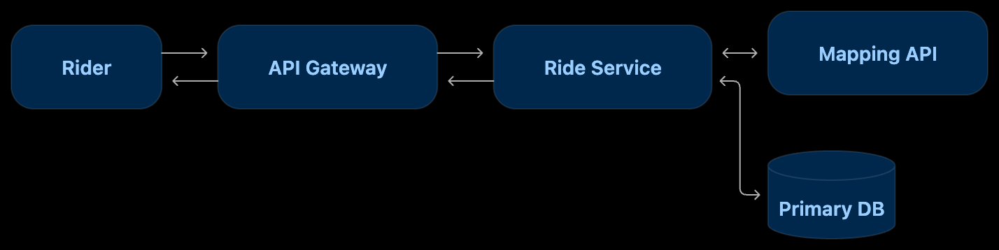
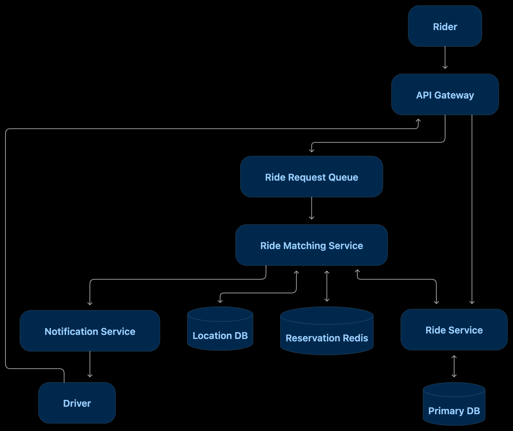

# ДЗ 1. Анализ референсной архитектуры — решение

> Условие: [../Задание.m
> d](../Задание.md) · Чек-лист: [../Чеклист.md](../Чеклист.md)
> Схемы складывайте в [diagrams/](diagrams/).

## Выбранная архитектура

### Сервис такси

#### Что делает система:
Сервис такси: ride-sharing платформа, которая соединяет 
пассажиров и водителей, предоставляющих услуги перевозки. 
Платформа позволяет пользователям заказывать поездки через 
мобильное приложение, подбирая ближайших доступных водителей.

#### Основные пользователи:
- Пассажир: рассчитывает стоимость, заказывает поездку и получает информацию о назначенном водителе.
- Водитель: передаёт геолокацию, получает предложения заказов, принимает или отклоняет их и выполняет поездки.
- Внешний картографический провайдер: предоставляет данные о маршрутах, расстояниях и времени поездки.

#### Ключевые сценарии использования.
- расчет предварительной стоимости
- подбор водителя
- оформление заказа
- обновление локаций водителя

#### Масштаб
- 24 миллиона заказов в сутки;
- 3 миллиона одновременно активных водителей;
- каждый водитель отправляет координаты раз в 5 секунд.
- нагрузка (без учета пиков)
  - Создание заказов
    - ≈ 278 RPS (24 000 000 / 86 400)
  - Обновление координат
    - 600 000 RPS (3 000 000 / 5)

## 1. Компоненты

| Компонент             | Тип                           | Состояние         | Ответственность                                               |
|-----------------------|-------------------------------|-------------------|---------------------------------------------------------------|
| API Gateway           | Инфраструктурный сервис       | Stateless         | Маршрутизация запросов, аутентификация, балансировка нагрузки |
| Ride Service          | Прикладной сервис             | Stateless         | Расчёт стоимости, создание и обновление заказов               |
| Primary DB            | База данных                   | Stateful          | Хранение заказов и их состояний                               |
| 3rd Party Mapping     | Внешняя интеграция            | Внешнее состояние | Расчёт маршрутов, расстояний и времени поездки                |
| Ride Matching Service | Прикладной сервис             | Stateless         | Поиск доступных водителей, подбор исполнителя                 |
| Location Service      | Прикладной сервис             | Stateless         | Приём и обработка обновлений координат водителей              |
| Location DB (Redis)   | Геопространственное хранилище | Stateful          | Хранение координат водителей и геопространственный поиск      |
| Ride Request Queue    | Очередь сообщений             | Stateful          | Буферизация запросов на подбор водителя                       |
| Reservation Redis     | In-memory хранилище           | Stateful          | Временное резервирование водителей                            |
| Notification Service  | Прикладной сервис             | Stateless         | Отправка уведомлений                                          |

## 2. Потоки данных

### Расчёт предварительной стоимости

Последовательность: пассажир отправляет точки начала и завершения поездки. 
API Gateway передаёт запрос в Ride Service. Сервис получает данные о маршруте 
через Mapping API и обращается к Primary DB (Тарифы, история поездок), 
после чего рассчитывает стоимость и возвращает ответ.

Взаимодействие: синхронное. При недоступности Mapping API повторный запрос
и ошибка пользователю в случае повторой недоступности.

### Обновление геолокации

Водитель отправляет запрос на обновление локации. Location Service обновляет 
координаты в Redis, после чего Matching Service может использовать их при поиске 
ближайших водителей.

Взаимодействие: синхронное. При недоступности Redis координаты не обновятся.

### Создание заказа и подбор водителя

Пассажир отправляет запрос создение поездки. Запрос поступает в очередь и затем обрабатывается Ride Matching Service. 
Сервис ищет кандидатов в Location DB, проверяет состояние через Ride Service и использует Redis для временного резервирования.

После выбора кандидата Notification Service отправляет водителю предложение. 
Водитель отвечает через API Gateway, а Ride Service обрабатывает принятие заказа.

Взаимодействие: асинхронное. Операции с Б выполняются через прямые вызовы. Если водитель не отвечает, система должна 
снять резервирование и продолжить поиск.

## 3. Проблемы и решения

| Компонент / решение     | Какую проблему решает                        | Что было бы без него?                                                            | Trade-off                                         |
|-------------------------|----------------------------------------------|----------------------------------------------------------------------------------|---------------------------------------------------|
| API Gateway             | Централизованная обработка входящих запросов | Инфраструктурная логика в сервисах                                               | Дополнительный сетевой переход                    |
| Ride Service            | Логика управления поездками                  | Логика заказов была бы распределена между компонентами                           | Усложнение мастшабирования                        |
| Location Service        | Изоляция геообновлений                       | Нагрузка на координаты мешала бы обработке заказов                               | Дополнительный сервис и сетевые вызовы            |
| Location DB (Redis GEO) | Быстрый поиск водителей по геопозиции        | Медленный поиск по большим объёмам координат                                     | Необходимость очистки устаревших                  |
| Ride Matching Service   | Алгоритма подбора                            | Сложная логика подбора нагружала бы другие сервисы                               | Дополнительная координация состояний              |
| Ride Request Queue      | Асинхронная обработка                        | Перегрузка Matching Service при всплесках заказов                                | Дополнительная задержка и риск накопления очереди |
| Reservation Redis       | Снижение риска двойного назначения водителя  | Конкурирующие запросы могли бы выбрать одного водителя                           | Гонки и необходимость атомарных операций          |
| Primary DB              | Хранение заказов и тарифов                   | Потеря истории и состояния поездок                                               | Затраты на согласованность и масштабирование      |
| Notification Service    | Доставка уведомлений                         | Matching Service пришлось бы самостоятельно интегрироваться с push-провайдерами  | Задержки и отсутствие гарантии получения push     |
| 3rd Party Mapping       | Расчет маршрутов                             | Пришлось бы разрабатывать маршрутизатор                                          | Зависимость от внешнего API                       |

- Масштабирование
  - Location DB 
    - Можем географически шардировать и настроить репликации
  - Ride Matching Service
    - Очередь позволяет независимо масштабировать количество обработчиков запросов
- Надежность
  - Ride Request Queue
    - служит буфером при всплесках нагрузки и может помочь пережить временную недоступность обработчиков при условии надёжного хранения сообщений.

## 4. Вопросы к авторам архитектуры

- Какие гарантии доставки обеспечивает Ride Request Queue? Как обрабатываются повторные сообщения и как предотвращается повторное создание назначения?
- Как масштабируется Location DB? Используется ли географическое шардирование Redis и как обрабатывается перемещение водителей между шардами?
- Как удаляются устаревшие координаты водителей?
- Что происходит, если водитель успешно зарезервирован, но обновление заказа в Primary DB завершилось ошибкой?
- Есть ли максимальное время ожидания заказа в очереди и механизм удаления устаревших запросов?