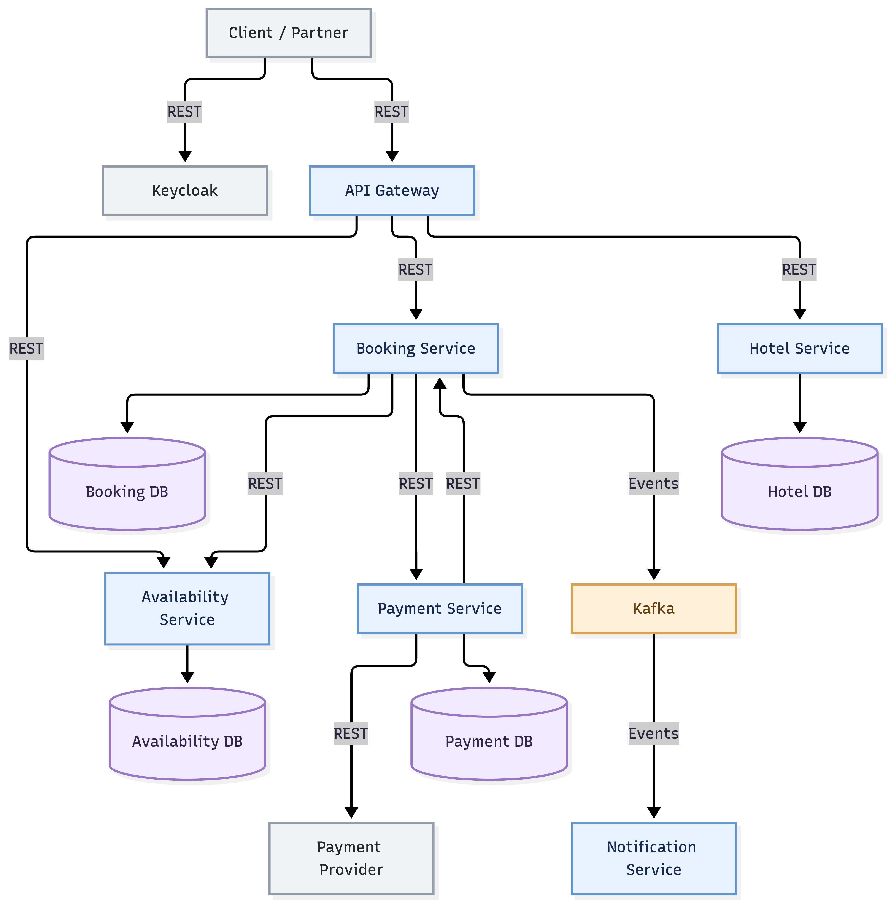

# ДЗ 2. Проектирование взаимодействия сервисов — решение

> Условие: [../Задание.md](../Задание.md) · Таблица протоколов: [../Таблица протоколов.md](../Таблица%20протоколов.md)
> Схемы складывайте в [diagrams/](diagrams/).

## Выбранная система

Сервис бронирования отелей — платформа, позволяющая пользователям искать отели, 
проверять доступность номеров на выбранные даты, бронировать их и оплачивать проживание.

Владельцы отелей могут добавлять свои объекты, управлять категориями номеров, ценами и доступностью для бронирования. 
Поиск отелей выполняется по параметрам каталога, а доступность номеров на выбранные даты проверяется отдельно через Availability Service.

## 1. Декомпозиция

| Компонент                | Тип              | Ответственность                                                                                                                                                  |
| ------------------------ | ---------------- |------------------------------------------------------------------------------------------------------------------------------------------------------------------|
| **API Gateway**          | Инфраструктурный | Единая точка входа для клиентских запросов. Маршрутизация, проверка JWT-токенов, Rate Limiting.                                                                  |
| **Keycloak**             | Инфраструктурный | Регистрация и аутентификация пользователей, управление ролями, выдача JWT-токенов. Развёрнут в собственной инфраструктуре.                                       |
| **Hotel Service**        | Бизнес-сервис    | Управление каталогом отелей, категориями номеров и тарифами. Поиск и фильтрация по данным каталога.                                                                                                    |
| **Availability Service** | Бизнес-сервис    | Проверка доступности номеров по датам, атомарное резервирование, подтверждение и освобождение резервов. Удержание номера на период оплаты и технической проверки.|
| **Booking Service**      | Бизнес-сервис    | Создание бронирований, управление их статусами и сроками оплаты. Оркестрация Saga для согласования резервирования и оплаты.                                  |
| **Payment Service**      | Бизнес-сервис    | Создание платёжных сессий, взаимодействие с Payment Provider, периодическая проверка статусов платежей (polling) и выполнение возвратов.                         |
| **Notification Service** | Бизнес-сервис    | Асинхронная отправка уведомлений о подтверждении, отмене, истечении срока бронирования и возврате средств.                                                                               |
| **Payment Provider**     | Внешняя система  | Проведение платежей на внешней платёжной странице. Предоставление REST API для создания платежей, проверки их статусов и выполнения возвратов.                   |

## 2. Протоколы

| Протокол / подход  | Где используется                                                                                                                                                               | Обоснование                                                                                                                                                       |
|--------------------|--------------------------------------------------------------------------------------------------------------------------------------------------------------------------------|-------------------------------------------------------------------------------------------------------------------------------------------------------------------|
| **REST**           | Взаимодействие клиентских приложений с API Gateway, между бизнес-сервисами и с внешним платёжным провайдером. Аутентификация через Keycloak с использованием OAuth 2.0 / OIDC. | Простота реализации и поддержки. Подходит для синхронных операций, требующих немедленного ответа, а также для периодической проверки статусов платежей (polling). |
| **Events (Kafka)** | Асинхронная передача событий от Booking Service к Notification Service.                                                                                                        | Позволяет отделить отправку уведомлений от основного процесса бронирования. Недоступность Notification Service не блокирует подтверждение бронирования.           |

## 3. Схема взаимодействия

[Архитектурная схема](diagrams/architecture.md)

[Бронирование](diagrams/booking-sequence.md)

## 4. API-контракты

### 1. Поиск отелей — Hotel Service

**`GET /hotels`**

Поиск отелей по заданным критериям каталога. Доступность номеров на конкретные даты этим запросом не проверяется.

- **Параметры:** `city`, `stars`, `guests`.
- **Ответ:** `200 OK` — список отелей с основной информацией и категориями номеров.
- **Ошибки:** `400 Bad Request` — некорректные параметры поиска.

### 2. Резервирование номера — Availability Service

**`POST /reservations`**

Внутренний API, вызываемый Booking Service для атомарного резервирования номера. 
Клиенту даётся 15 минут на оплату, после чего резерв может удерживаться ещё до 2 минут для технической проверки платежа.

- **Параметры:** `bookingId`, `roomTypeId`, `checkIn`, `checkOut`.
- **Ответ:** `201 Created` — `reservationId`, `expiresAt`.
- **Ошибки:** `409 Conflict` — нет свободных номеров на выбранные даты.

### 3. Создание бронирования — Booking Service

**`POST /bookings`**

Создание бронирования с резервированием номера и получением ссылки на оплату.

- **Параметры:** `hotelId`, `roomTypeId`, `checkIn`, `checkOut`, `guests`. Пользователь определяется по токену доступа.
- **Ответ:** `201 Created` — `bookingId`, `status: PENDING_PAYMENT`, `paymentUrl`, `expiresAt`.
- **Ошибки:**
    - `400 Bad Request` — некорректные данные.
    - `401 Unauthorized` — пользователь не авторизован.
    - `409 Conflict` — номер недоступен.

### 4. Получение статуса бронирования — Booking Service

**`GET /bookings/{bookingId}`**

Получение информации о бронировании. Используется клиентом для периодической проверки статуса (polling).

- **Параметры:** `bookingId`.
- **Ответ:** `200 OK` — `bookingId`, `status`, `paymentUrl`, `expiresAt`.
- **Ошибки:**
    - `403 Forbidden` — бронирование принадлежит другому пользователю.
    - `404 Not Found` — бронирование не найдено.

## 5. Асинхронность

| Взаимодействие                                    | Тип                  | Обоснование                                                                                                                                                                                |
|---------------------------------------------------|----------------------|--------------------------------------------------------------------------------------------------------------------------------------------------------------------------------------------|
| Client → API Gateway → Hotel Service              | Синхронное (REST)    | Пользователю необходимо сразу получить результаты поиска отелей.                                                                                                                           |
| Client → API Gateway → Booking Service            | Синхронное (REST)    | Пользователь ожидает подтверждения резервирования и ссылку на оплату.                                                                                                                      |
| Booking Service → Availability Service            | Синхронное (REST)    | Необходимо проверить доступность номера и гарантировать его резервирование перед созданием платежа.                                                                                        |
| Booking Service → Payment Service                 | Синхронное (REST)    | Необходимо создать платёж и получить ссылку на оплату.                                                                                                                                     |
| Payment Service → Payment Provider                | Синхронное (REST)    | Создание платежа и периодическая проверка его статуса (polling). Каждый запрос выполняется синхронно, но проверки запускаются независимо от клиентского запроса.                           |
| Payment Service → Booking Service                 | Синхронное (REST)    | Передача результата оплаты для изменения статуса бронирования.                                                                                                                             |
| Booking Service → Notification Service            | Асинхронное (Events) | Отправка уведомлений не должна блокировать основной процесс бронирования. Kafka обеспечивает буферизацию событий и возможность повторной обработки при недоступности Notification Service. |
| Client → API Gateway → Booking Service (polling)  | Синхронное (REST)    | Клиент периодически запрашивает актуальный статус бронирования, не удерживая открытое соединение.                                                                                          |

## 6. Паттерны

Saga (Orchestration) — применяется в Booking Service для координации резервирования номера через Availability Service и оплаты через Payment Service. 
Позволяет управлять распределённым бизнес-процессом без общей транзакции между сервисами. 
При возникновении ошибок выполняются компенсирующие действия: освобождение резерва или возврат средств.

Истечение резерва и позднее подтверждение оплаты. Booking Service контролирует срок оплаты — 15 минут с момента создания резерва. 
Если подтверждение не получено, бронирование переходит в PAYMENT_CHECK, а Availability Service продолжает удерживать номер 
ещё до 2 минут для окончательной проверки платежа.

Если своевременная оплата подтверждена до окончания проверки, бронирование переходит в CONFIRMED. 
В противном случае Booking Service переводит его в EXPIRED, освобождает резерв и инициирует отмену платежа.

Если результат платежа остаётся неизвестным, Payment Service продолжает проверку через polling. 
При получении подтверждения оплаты после освобождения номера Booking Service инициирует возврат средств.

Операции подтверждения и освобождения резерва должны быть атомарными и идемпотентными.